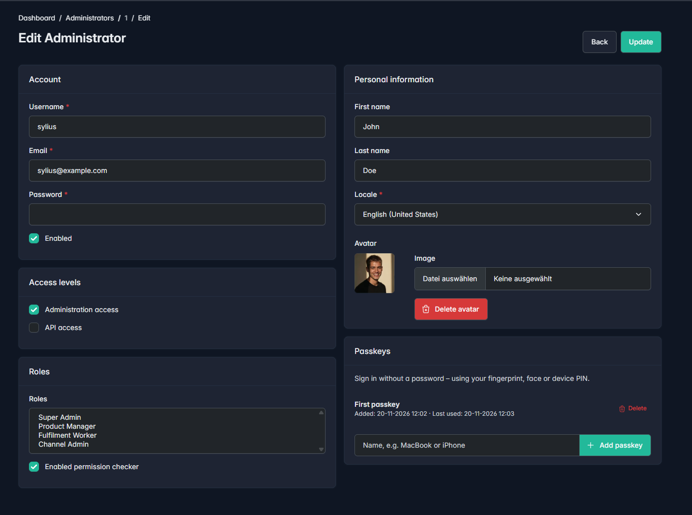
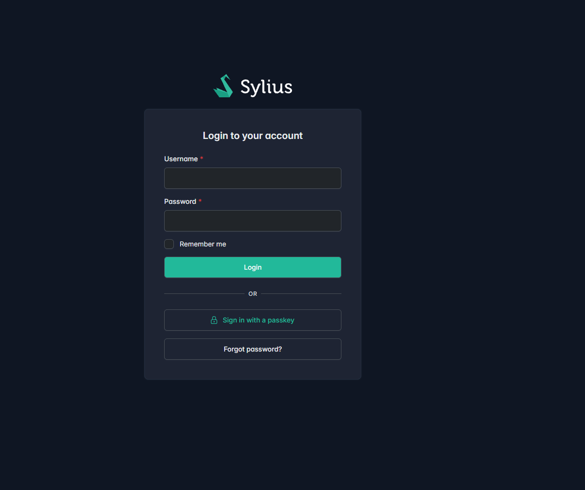
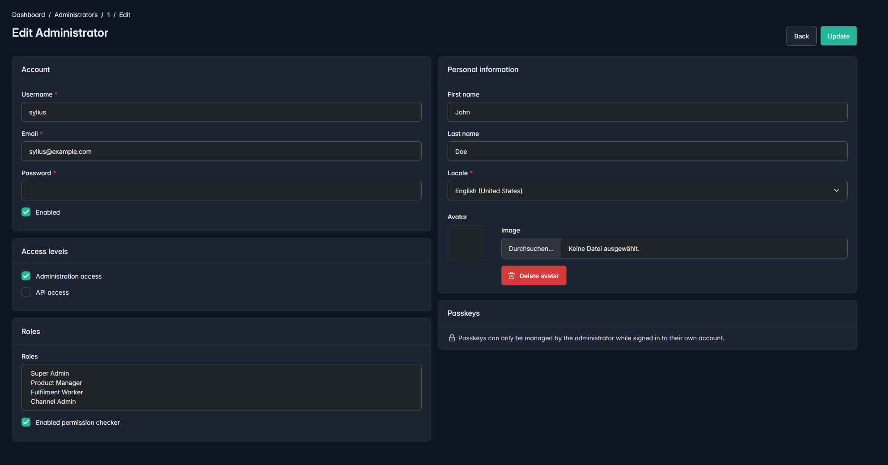

# Sylius Admin Passkey Login Plugin

Lets Sylius administrators sign in with a **passkey** (WebAuthn / FIDO2) instead of a password —
using Touch ID, Face ID, Windows Hello, Android, a password manager or a security key.

Built on top of [`web-auth/webauthn-symfony-bundle`](https://github.com/web-auth/webauthn-framework).

## Features

- Admins add and delete passkeys on the edit page of **their own** account
  (Administrators → *your user* → Edit). Other admins only see a notice.
- The administrators grid shows which admins have a passkey.
- The login page gets a **"Sign in with a passkey"** button. No username has to be typed
  (discoverable credentials).
- The password login keeps working.
- Translations: English, German.

## Requirements

| | Version |
|---|---|
| PHP | 8.4 |
| Sylius | 2.1 – 2.3 with Symfony 7.4, Sylius 2.3 with Symfony 8 |
| Database | MySQL / MariaDB or PostgreSQL |

WebAuthn only works on **HTTPS** (or `localhost`). The browser has to support the WebAuthn JSON helpers
(Chrome/Edge 129+, Firefox 119+, Safari 18.4+); in older browsers the passkey UI is hidden.

## Demo

### Managing passkeys



### Signing in with a passkey



### Other admins' accounts

Only the currently logged-in admin can manage their own passkeys.



## Installation

1. Require the plugin:

    ```bash
    composer require skrull/sylius-admin-passkey-login-plugin
    ```

2. Register the bundles in `config/bundles.php` (the WebAuthn bundle must come first):

    ```php
    return [
        // ...
        Webauthn\Bundle\WebauthnBundle::class => ['all' => true],
        SKrull\SyliusAdminPasskeyLoginPlugin\SKrullSyliusAdminPasskeyLoginPlugin::class => ['all' => true],
    ];
    ```

3. Import the plugin configuration in `config/packages/skrull_sylius_admin_passkey_login.yaml`:

    ```yaml
    imports:
        - { resource: "@SKrullSyliusAdminPasskeyLoginPlugin/config/config.yaml" }
    ```

4. Import the routes in `config/routes/skrull_sylius_admin_passkey_login.yaml`:

    ```yaml
    skrull_sylius_admin_passkey_login_admin:
        resource: "@SKrullSyliusAdminPasskeyLoginPlugin/config/routes/admin.yaml"
    ```

5. Enable the passkey login in the `admin` firewall in `config/packages/security.yaml`:

    ```yaml
    security:
        firewalls:
            admin:
                # ... existing configuration (form_login, remember_me, ...)
                webauthn:
                    authentication:
                        profile: skrull_admin_passkey
                        routes:
                            options_path: '/%sylius_admin.path_name%/login/passkey/options'
                            result_path: '/%sylius_admin.path_name%/login/passkey'
                    success_handler: skrull_sylius_admin_passkey_login.security.passkey_authentication_success_handler
    ```

    Both paths are below `/admin/login`, which Sylius already allows for anonymous users.
    The block has to be added to your own `security.yaml`: Symfony only accepts new firewall settings
    from the file that defines the firewalls, so the plugin cannot ship it.
    Without this block, passkeys can still be managed, but the login page shows no passkey button.

6. Run the migrations (MySQL/MariaDB and PostgreSQL are supported):

    ```bash
    bin/console doctrine:migrations:migrate
    ```

7. Add the plugin JavaScript to your admin entry point `assets/admin/entrypoint.js` and rebuild the assets:

    ```js
    import '../../vendor/skrull/sylius-admin-passkey-login-plugin/assets/admin/entrypoint';
    ```

    ```bash
    yarn build
    ```

8. Clear the cache:

    ```bash
    bin/console cache:clear
    ```

## Configuration

The plugin pre-configures the WebAuthn bundle with its own profile `skrull_admin_passkey`.
Every value can be overridden in `config/packages/webauthn.yaml`, for example the name shown by the browser:

```yaml
webauthn:
    creation_profiles:
        skrull_admin_passkey:
            rp:
                name: 'My Shop Administration'
```

Defaults: discoverable credentials (`resident_key: required`), user verification required
(fingerprint, face or PIN), no attestation, algorithms ES256 and RS256.

The plugin sets the global options `webauthn.credential_repository` and `webauthn.user_repository`.
If your shop already uses the WebAuthn bundle for other users (e.g. customers), you need repositories
that handle both.

## Security notes

- A passkey is always attached to the **logged-in** admin; the registration endpoints never take a user
  from the request.
- Deleting a passkey requires a CSRF token. A passkey of another admin is answered with `404`.
- The login response does not reveal whether an account exists or has a passkey; unknown usernames get
  fake, stable credential IDs from the WebAuthn bundle.
- Disabled admins cannot sign in with a passkey (the firewall user checker applies).
- Cloned authenticators are detected through the signature counter where the authenticator supports it.

## Development

The repository contains a Sylius test application. With [DDEV](https://ddev.com):

```bash
ddev start
ddev bootstrap
```

The shop is then available at `https://syliusadminpasskeyloginplugin.ddev.site/admin` (user `sylius`,
password `sylius`). To try passkeys without a real device, use Chrome DevTools → *More tools* →
*WebAuthn* → *Enable virtual authenticator environment* and add an authenticator with resident key and
user verification support.

Checks:

```bash
ddev exec vendor/bin/phpunit
vendor/bin/phpstan analyse
vendor/bin/ecs check
```

## License

MIT, see [LICENSE](LICENSE).
